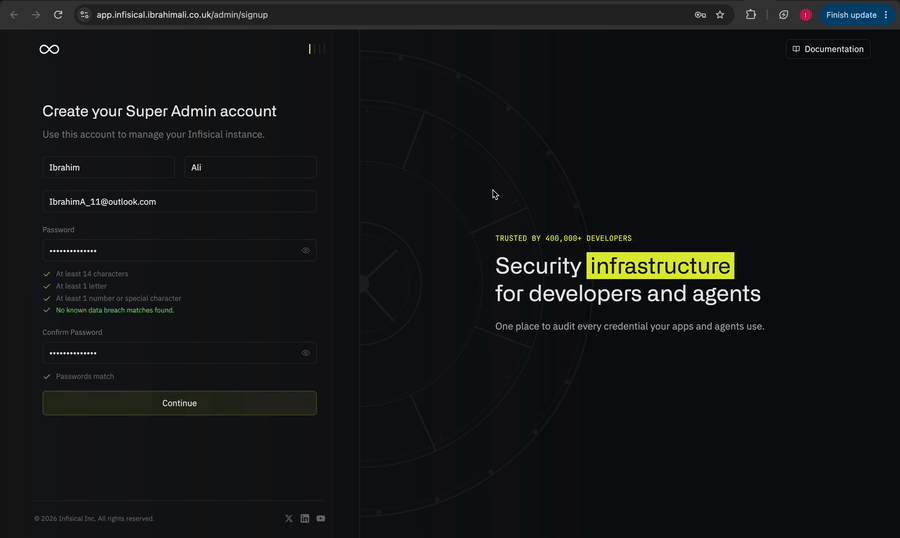
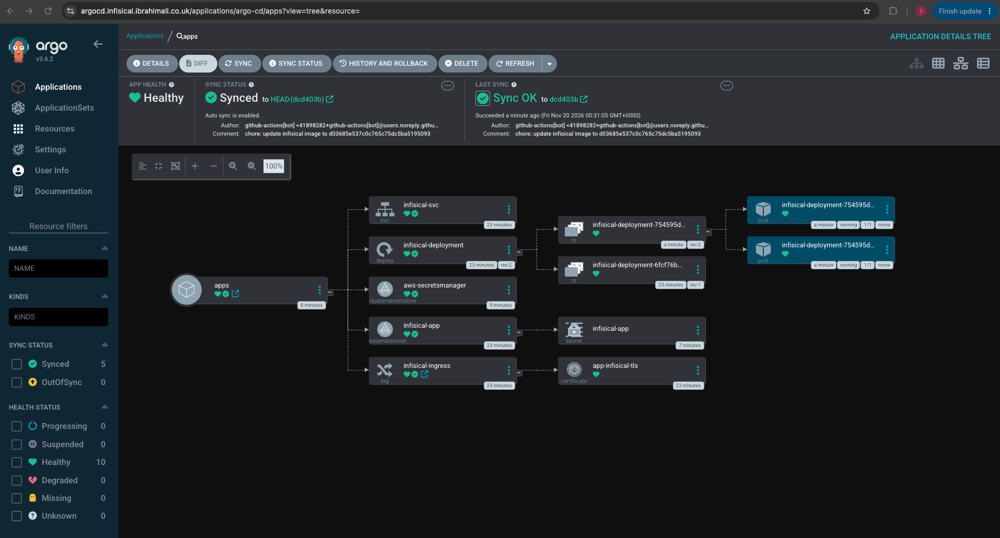
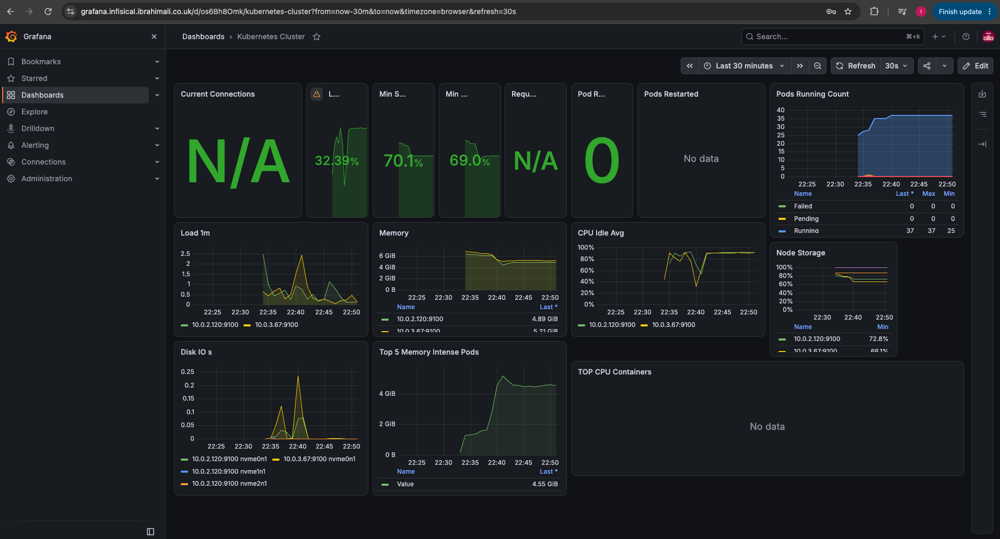
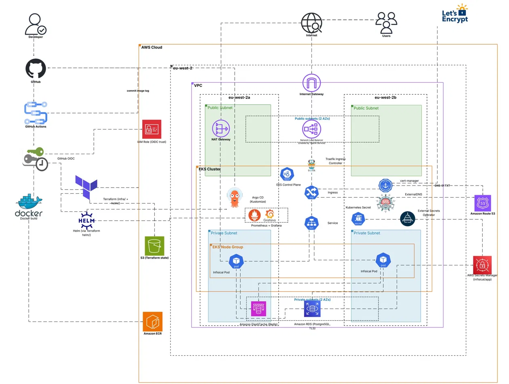
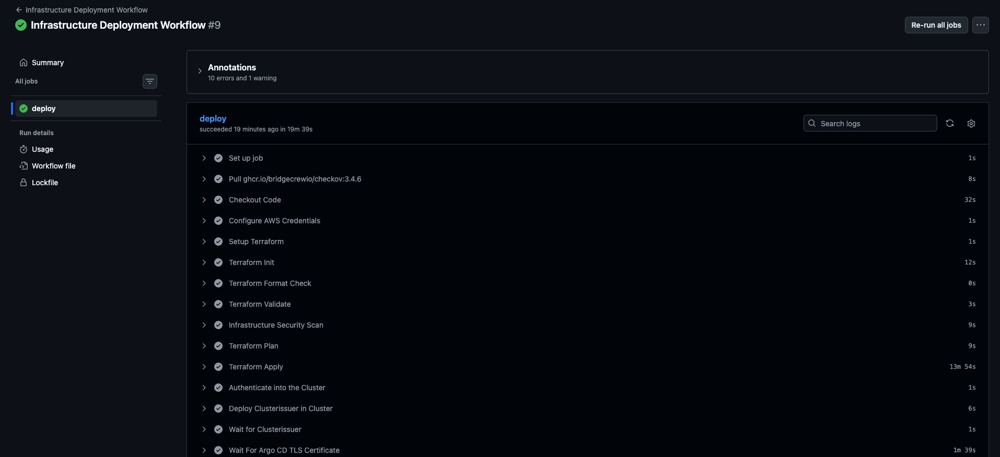
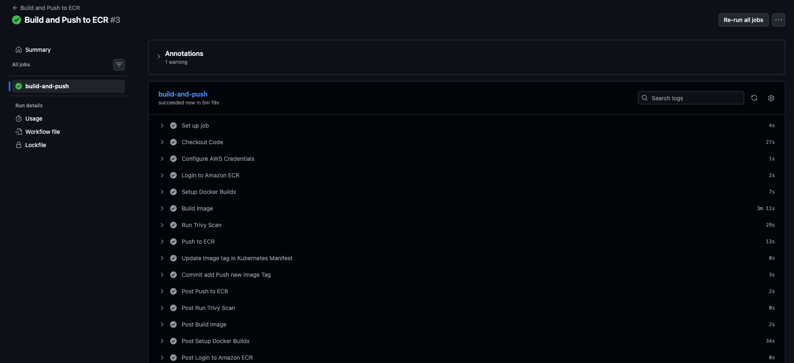
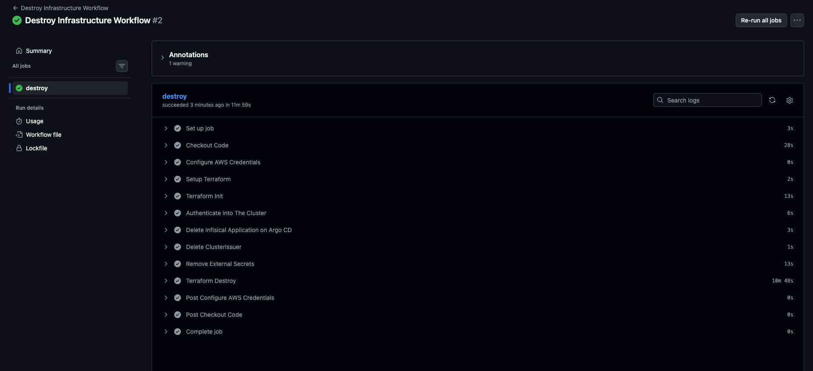
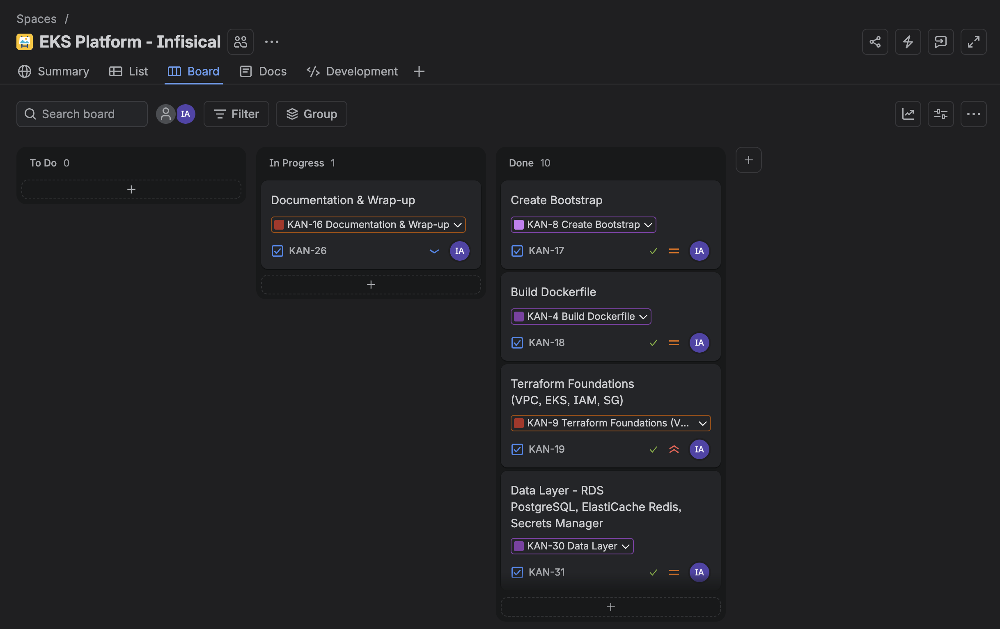

# Infisical on EKS - A Production-Style Kubernetes Platform on AWS


## Project Overview

This project deploys **Infisical**, an open-source secrets management platform, to **Amazon EKS** - along with the entire platform it needs to run: VPC, EKS cluster, IAM, Ingress, DNS, TLS, a PostgreSQL database, a Redis cache and monitoring, all built with Terraform.

Infisical is a step up from a single-binary app. It needs a database, a cache, and several secrets that must never change once data exists. The goal was to practise everything around getting it onto Kubernetes properly: scoping permissions per workload, generating secrets that never touch the Terraform state file, connecting to RDS over verified TLS, deploying new images without touching the cluster, and rebuilding the whole thing identically after a teardown.

## Live Endpoints

| Service | URL | Live |
|---|---|---|
| Infisical Overview | https://app.infisical.ibrahimali.co.uk |  | |
| Argo CD | https://argocd.infisical.ibrahimali.co.uk |  |
| Grafana | https://grafana.infisical.ibrahimali.co.uk |  |

**I tear the cluster down between sessions so it isn't costing me money while I'm not working on it, so these are only live when the platform is up.**

## Local Setup

Infisical needs PostgreSQL and Redis alongside it, so the local setup runs all three on one Docker network through the **docker compose** file:

```bash
cd app
docker build -t infisical:latest .

# Set image: infisical:latest in docker-compose.prod.yml, and fill in the
# required values (ENCRYPTION_KEY, AUTH_SECRET) in the .env file it reads
docker compose -f docker-compose.prod.yml up -d
```

Then open `http://localhost:8080` and create the first account, which becomes the instance admin.

### To deploy the full platform to AWS

```bash
# 1. Bootstrap - S3 state bucket, ECR repo, GitHub OIDC role
cd bootstrap
terraform init && terraform apply

# 2. Cloud infrastructure - VPC, EKS, IAM, RDS, ElastiCache, Secrets Manager, Helm
cd ../infra
terraform init && terraform apply

# 3. Cluster access, then the issuer and the application
aws eks update-kubeconfig --region eu-west-2 --name infisical-eks-cluster
kubectl apply -f ../cert-manager/issuer.yaml
kubectl apply -f ../argo-cd/infisical-argo.yaml
```

## Architecture Diagram



**The diagram shows the VPC boundary and both Availability Zones, the public subnets holding the Network Load Balancer and NAT Gateway, the private subnets holding the EKS managed node group, the RDS instance and the ElastiCache node, and the scope outside the VPC, including Route 53, ECR, Secrets Manager and Let's Encrypt.**

## How a request reaches the app

1. `app.infisical.ibrahimali.co.uk` resolves via a Route 53 record that **ExternalDNS** created from the Ingress object.
2. That record points at the AWS Network Load Balancer in front of **Traefik**, running as two replicas spread across nodes.
3. Traefik terminates TLS with a Let's Encrypt certificate that **cert-manager** issued through a Route 53 DNS-01 challenge and keeps renewed.
4. The request goes to the Infisical ClusterIP Service, which spreads traffic across the two Infisical pods.
5. Those pods sit in private subnets in two AZs. They store their data in a private **RDS PostgreSQL** instance, over TLS verified against the RDS CA bundle, and use **ElastiCache Redis** for caching and background jobs.

## Project Structure

```
.
├── .github/
│   └── workflows/
│       ├── deploy.yaml              # Terraform + Checkov for infra/, then the Argo CD app
│       ├── docker-build-push.yaml   # Docker build, Trivy scan, push to ECR, commit new image tag
│       └── destroy.yaml             # Manual teardown, in the right order
│
├── app/
│   ├── Dockerfile
│   └── App source code              # Infisical source
│
├── bootstrap/                       # Run once - state bucket, ECR repo, OIDC role
│   └── modules
│       └── s3/  ecr/  oidc/
│
├── infra/                           # Terraform - cloud infrastructure + cluster add-ons
│   ├── main.tf provider.tf variable.tf output.tf
│   └── modules/
│       ├── vpc/  sg/  iam/  eks/  rds/
│       └── helm/
│           └── values/  # argocd, traefik, cert-manager, external-dns, kube-prometheus-stack, reloader
│
├── kubernetes/                      # Manifests synced by Argo CD
│   ├── kustomization.yaml           # Resource list + the image tag the pipeline updates
│   ├── cluster-secret-store.yaml
│   ├── external-secret.yaml
│   ├── deployment.yaml
│   ├── service.yaml
│   └── ingress.yaml
│
├── argo-cd/
│   └── infisical-argo.yaml          # Argo CD Application pointing at kubernetes/
│
├── cert-manager/
│   └── issuer.yaml                  # Let's Encrypt ClusterIssuer, DNS-01 via Route 53
│
├── .pre-commit-config.yaml
└── README.md
```

## Multi-stage build: image size

The Dockerfile uses a multi-stage build. The first stage installs all dependencies and builds the app. The final stage copies in only the built output and production dependencies, so build tools and dev dependencies never ship.

| Build | Disk Usage | Content size |
|---|---|---|
| Single-stage | 5.3 GB | 1.27 GB |
| **Multi-stage** | **1.67 GB** | **268 MB** |
| **Reduction** | **~68% smaller** | **~79% smaller** |

Content size is roughly what gets pushed to ECR and pulled by each node. A smaller image means:

- **Faster pod start-up.** New nodes and rollouts pull ~1 GB less per image.
- **Lower ECR storage costs.** Every commit pushes a new tagged image.
- **Smaller attack surface.** Fewer packages in the final image for Trivy to scan and flag.

## The stack, layer by layer

### Application

- Infisical, an open-source secrets management platform with a Node.js backend and a web UI
- Multi-stage Docker build, built for `linux/amd64` to match the EKS nodes, running as a non-root user
- Private ECR repository with scan-on-push
- Two replicas on separate nodes via `podAntiAffinity`
- All configuration supplied as environment variables from a single Kubernetes Secret - no ConfigMap, nothing hard-coded

### Infrastructure

- Amazon EKS with a managed node group in private subnets
- VPC with two public and two private subnets across two Availability Zones
- Internet Gateway, and a single NAT Gateway for private egress
- Security groups for the cluster, the nodes, the database and Redis - each data store only accepts traffic from the nodes
- Amazon RDS for PostgreSQL - encrypted, private, gp3 with storage autoscaling
- Amazon ElastiCache for Redis - private, reachable only from the nodes on port 6379
- Secrets Manager holding every Infisical secret in one fixed-name secret, `infisical/app`
- Amazon ECR and Route 53
- IAM roles for the cluster, the nodes and individual workloads, via EKS Pod Identity
- S3 bucket for Terraform state, encrypted, with native state locking

### Kubernetes Platform

7 Helm releases, all declared as Terraform `helm_release` resources:

- Argo CD
- Traefik Ingress Controller
- Cert Manager
- External DNS
- External Secrets Operator
- Stakater Reloader
- kube-prometheus-stack

### Monitoring

- Prometheus, via `kube-prometheus-stack`, collecting metrics from the cluster, including pods, nodes, and services, plus Traefik's own metrics through a ServiceMonitor.
- Grafana, exposed at `grafana.infisical.ibrahimali.co.uk` behind its own Ingress, with a cert-manager certificate and an ExternalDNS record.
- Dashboards showing pod and node CPU and memory usage, pod health, node status, and ingress traffic through Traefik.

### Delivery
- Three GitHub Actions workflows: deployment, image build, teardown
- GitHub OIDC authentication to AWS, no stored keys
- Argo CD syncing the application manifests from this repo, with self-healing and pruning
- Fully automated image rollout: after pushing a new image to ECR, the build pipeline writes its commit SHA into `kubernetes/kustomization.yaml` and pushes that change. Argo CD picks it up and rolls out the new pods.

### Security
- OIDC-based CI authentication, so no long-lived AWS credentials exist anywhere
- Per-workload IAM roles through Pod Identity, each scoped to one resource - cert-manager can only write TXT records in one hosted zone, and External Secrets can only read one secret
- **No secrets in Terraform state.** The database password, Infisical's encryption key and its auth secret are generated as Terraform ephemeral values and passed through write-only arguments (`password_wo`, `secret_string_wo`), so they never appear in the plan or the state file. Only a version number is stored, and bumping it rotates the database and Secrets Manager values together.
- Secrets reach the pods only through External Secrets, so no manifest, ConfigMap or Git commit contains them
- Database connections use TLS verified against the AWS RDS CA bundle
- Every workload in a private subnet; the database and Redis not publicly accessible
- Checkov on the Terraform, Trivy on the image, ECR scan-on-push
- pre-commit hooks running gitleaks, private-key detection, `terraform fmt`, `validate` and `tflint` before anything reaches CI
- HTTPS on every hostname, issued and renewed automatically

## Pipelines

**Infrastructure Deployment**



**Docker Build and Push**



**Teardown**



## Agile Project Management

Work was planned and tracked in Jira. The project is broken into epics that map to delivery phases, each with its own tasks, so the build order was decided up front and progress was visible throughout:

- **Build Dockerfile** - multi-stage build for Infisical
- **Create Bootstrap** - state bucket, ECR repository, GitHub OIDC role
- **Terraform Foundations** - VPC, EKS, IAM, SG, RDS
- **Data Layer** - RDS PostgreSQL, ElastiCache Redis, Secrets Manager
- **Ingress & TLS** - Traefik, cert-manager, Let's Encrypt
- **DNS Automation** - ExternalDNS and Route 53
- **CI/CD Pipeline 1** - Terraform plan/apply with Checkov
- **CI/CD Pipeline 2** - App Build & Deploy with Trivy, image tag committed back for Argo CD
- **GitOps with ArgoCD** - Deploys manifest files from Git repo structure, with auto-sync
- **Monitoring** - Prometheus & Grafana, collecting metrics and displaying through dashboards
- **Documentation & Wrap-up**

### Jira Board



## Learning Curves

- **Secrets in Terraform state.** Review feedback pointed out that `random_password` and `secret_string` leave plaintext secrets in the state file, so anyone with read access to the state bucket could read the database password and Infisical's encryption key. I moved to Terraform ephemeral resources and write-only arguments (`password_wo`, `secret_string_wo`), so the secrets never appear in the plan or the state. Only a version number is stored, and bumping it rotates the database and Secrets Manager values together.
- **Required anti-affinity deadlocks rollouts on a two-node cluster.** A deploy stalled with a pod `Pending` and `0/2 nodes are available: 2 node(s) didn't match pod anti-affinity rules`. With two replicas the default strategy works out to `maxSurge: 1, maxUnavailable: 0`, so Kubernetes tries to start a third pod before removing either old one, but strict anti-affinity forbids a third on a two-node cluster. Fixed with `maxSurge: 0, maxUnavailable: 1`, which removes a pod before replacing it. The rollout strategy assumes spare scheduling capacity; strict anti-affinity removes it.
